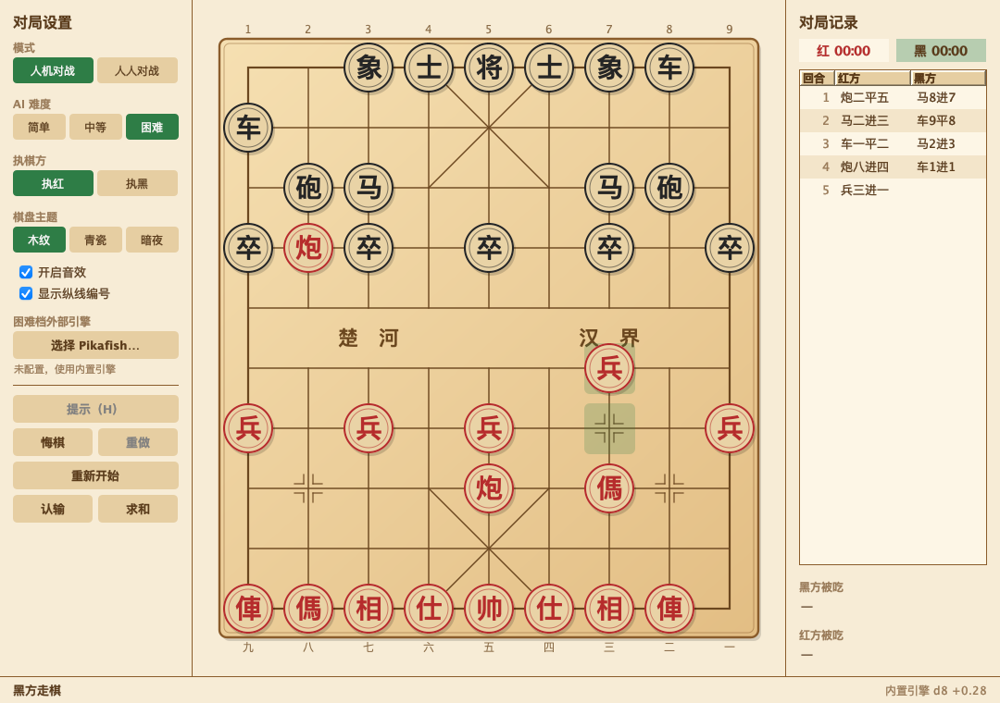

# 中国象棋 / Chinese Chess

一个用 Java Swing 写的单机中国象棋：人人对战、三档人机、悔棋重做、棋谱存取、复盘回看、三套主题。
内置引擎是完整的 alpha-beta 搜索（PVS + 置换表 + 空着裁剪 + 静态搜索），也可接 Pikafish。

A desktop Chinese Chess game built with Java Swing — local PvP, three AI levels, undo/redo,
game record save & load, move-by-move replay, and three board themes.



<sub>木纹主题。另有青瓷、暗夜两套：`docs/screenshot-celadon.png`、`docs/screenshot-night.png`</sub>

---

## 功能

### 对局
- **人人对战 / 人机对战**，人机三档：简单、中等、困难
- 执红或执黑；执黑时**棋盘自动翻转**，视角永远是自己在下
- **点选两步走** 与 **按住拖拽** 两种走子方式并存
- 合法落点提示、吃子提示、最后一步高亮、将军红圈脉动
- **悔棋 / 重做**：人机模式下一次退/进双方各一步
- **认输 / 求和**：人机模式下 AI 会按子力差决定是否接受和棋
- **双方用时**统计，落子即刷新
- **大师级提示**：独立引擎（优先 Pikafish，4 线程）给出推荐着法，蓝色箭头标注，
  同时显示引擎主变着的后续两三手、评估分与搜索深度（约 2.5 秒返回）

### 棋谱
- 保存 / 载入 `.xq` 棋谱（PGN 风格头 + 中文记谱 + 大括号内 UCI 坐标，人能读、程序能回放）
- 导出纯中文记谱 `.txt`，方便复制分享
- **点击右侧着法表任意一手即可回看当时局面**，点最新一手或按 `U` 返回对局

### 界面
- 窗口可自由缩放，棋盘与棋子等比自适应，支持高分屏
- 三套主题：木纹、青瓷、暗夜
- 传统棋盘细节：外框贯通、九宫斜线、炮兵位标记、楚河汉界、双方纵线编号
- 音效由代码合成并缓存，落子即响，不滞后

### 规则
将死、困毙判负；三次重复局面判和；**长将作负**；将帅照面非法；送将非法。

---

## 快速开始

需要 **JDK 17 或更高**。

```bash
git clone https://github.com/neoleegm/ChineseChess.git
cd ChineseChess

./build.sh     # 编译并打包到 build/ChineseChess.jar
./run.sh       # 启动游戏
./test.sh      # 运行全部测试
```

也可以直接用 jar：

```bash
java -jar build/ChineseChess.jar
```

> 请在项目根目录启动，程序会自动发现同目录下的 `pikafish` 引擎。

---

## 操作

| 操作 | 方式 |
|---|---|
| 走子 | 点棋子再点目标格，或直接拖拽 |
| 取消选择 | 再点一次选中的棋子 |
| 复盘 | 点击右侧着法表任意一行 |
| 返回对局 | 点击最新一手，或按 `U` |

| 快捷键 | 功能 |
|---|---|
| `U` | 悔棋 |
| `Y` | 重做 |
| `R` | 重新开始 |
| `H` | 提示（人机对战） |
| `F` | 翻转棋盘 |
| `⌘/Ctrl + S` | 保存棋谱 |
| `⌘/Ctrl + O` | 载入棋谱 |
| `F1` | 游戏规则 |
| `Q` | 退出 |

---

## 项目结构

```
ChineseChess/
├── src/main/java/xiangqi/
│   ├── app/      Main.java                程序入口
│   ├── core/     Board Piece Move         规则层：走法生成、合法性、终局裁决、Zobrist
│   │             Notation Fen Uci GameResult
│   ├── ai/       SearchEngine Evaluation  引擎层：PVS 搜索、评估、UCI 适配、难度门面
│   │             UciEngine AiPlayer
│   │             Difficulty SearchLimits SearchResult Engine
│   ├── game/     GameSession GameRecord   对局层：状态迁移、悔棋重做、复盘、棋谱读写
│   ├── ui/       MainFrame BoardView      视图层：绘制、交互、主题、AI 调度
│   │             SidebarPanel RecordPanel
│   │             Theme SegmentedControl Ui Dialogs AiWorker
│   └── audio/    SoundBank.java           音效合成与缓存
├── src/test/java/xiangqi/test/            37 个自动化用例（规则/引擎/会话/渲染）
├── docs/                                  截图与审视报告
├── build.sh  run.sh  test.sh              零依赖构建脚本
└── .github/workflows/ci.yml               GitHub Actions
```

依赖方向严格单向：`ui → game → ai → core`。`core` 与 `ai` 不依赖 Swing，
所以整局棋和整个引擎都能在无头环境里跑测试。

---

## 技术要点

### 规则层

- **走法生成**：先产生伪合法着法（`int` 打包），再逐个试走过滤自将，规则只校验一次。
- **被将判定**：从将帅格**反向探测**攻击源——四方向射线找车/炮/将（顺带覆盖将帅照面）、
  八个马位反查蹩腿点、三个兵位反查。单次判定约 20 次查表，不再「遍历所有敌子逐个试」。
- **将帅位置增量维护**，判定被将时不必全盘扫描。
- **重复局面**：维护历史局面键序列，三次重复时只回溯最近一个循环，O(n) 完成长将裁决。
- **线程模型**：`Board` 不加锁。界面线程持有对局棋盘，AI 在 `copy()` 出的副本上工作。

### 引擎

迭代加深 + PVS + 置换表（1M 项）+ 空着裁剪 + 后期着法削减（LMR）+
杀手/历史启发 + 被将延伸 + 静态搜索（被将时搜索全部应将着法，不用 stand-pat）+
搜索路径上的长将感知重复评分。

| 难度 | 策略 | 时间预算 |
|---|---|---|
| 简单 | 两层搜索 + 静态搜索，在最优着法 0.6 兵以内随机挑一手（会吃子、不白送，看不到三步以上的战术） | 0.6 s |
| 中等 | 完整 alpha-beta + 静态搜索，深度上限 6 | 1.2 s |
| 困难 | 迭代加深，深度上限 64；配置了 Pikafish 则交给它 | 8 s |

### 性能

走法生成从初始局面穷举合法着法（perft），与公开基准值完全一致：

| 深度 | 节点数 | 旧实现 | 当前实现 | 提升 |
|---|---|---|---|---|
| 1 | 44 | 1 ms | <1 ms | — |
| 2 | 1,920 | 7 ms | 2 ms | 3.5× |
| 3 | 79,666 | 83 ms | 15 ms | 5.5× |
| 4 | 3,290,240 | 1,481 ms | 240 ms | **6.2×** |

细节见 [docs/PRODUCT_REVIEW.md](docs/PRODUCT_REVIEW.md)。

---

## 测试

```bash
./test.sh
```

```
[规则与走法]  19 项：FEN 序列化与解析、UCI、perft、七种棋子走法、牵制、照面、
              将死、困毙、三次重复、长将、悔棋还原、克隆隔离、记谱、攻击判定
[AI 引擎]      8 项：吃白送车、一步杀、三档合法性、时间上限、长将自保、
              简单档不白送子、UCI 局面命令、自对弈
[对局会话]    7 项：悔棋成对、重做对称、复盘、认输、棋谱往返、计时、AI 回合
[界面渲染]    3 项：三套主题绘制、翻转生效、历史局面绘制
```

`perft` 是走法生成的黄金标准：深度 1–4 必须等于 **44 / 1920 / 79666 / 3290240**，
任何蹩马腿、塞象眼、将帅照面、送将判定的疏漏都会立刻让数字对不上。

生成 README 截图（离屏渲染，无需显示器）：

```bash
java -cp build/classes:build/test-classes xiangqi.test.Snapshot docs/screenshot.png 1080 760 木纹
```

---

## 外部引擎（可选）

仓库内置官方 Pikafish 2026-01-02（Apple Silicon）与配套 `pikafish.nnue`，开箱即用：
只要 `pikafish` 在启动目录下，困难档会自动使用它。

自行配置：

1. 从 [Pikafish Releases](https://github.com/official-pikafish/Pikafish/releases) 下载对应平台版本，
   把可执行文件与 `pikafish.nnue` 放在同一目录。
2. 侧边栏点「选择 Pikafish…」，选中可执行文件。
3. 路径保存在 Java Preferences 中；启动失败或连续返回非法着法时会自动回退内置引擎。

引擎以 4 线程 / 128 MB 置换表启动，并在程序启动时后台预热（握手 + 加载神经网络），
所以第一次按「提示」不会额外等待。提示会带上引擎给出的主变着（PV）与评估：
`提示：炮二平五 → 马8进7 马二进三 · d24 +0.35`。

> `pikafish.nnue` 约 53 MB，已被 `.gitignore` 排除，需自行从官方发布包获取。

---

## Changelog

### v4.0
- **架构重构**：拆分为 `core / ai / game / ui / audio` 五个包，`ChessPanel`（1095 行）拆成
  `BoardView` + `GameSession` + `MainFrame` + `SidebarPanel` + `RecordPanel`
- **性能**：重写走法生成与被将判定，去掉热路径锁，perft 提速 6.2×
- **正确性**：修正黑方将/士/象 PST 恒为 0 的评估偏差；静态搜索被将时改为搜索全部应将
- **新功能**：翻转棋盘、拖拽走子、窗口自适应、重做、认输、求和、双方用时、
  棋谱保存/载入/导出、点击复盘、三套主题、引擎深度与评分显示
- **工程化**：`build.sh / run.sh / test.sh`、GitHub Actions CI、37 个自动化用例（含 perft）
- 音效改为预渲染 Clip，消除落子音效延迟
- 简单档从「一步静态评估」升级为「两层搜索 + 根节点随机」，不再白送子

### v3.2 及更早
见 `git log`。

---

## English

A desktop Chinese Chess (Xiangqi) game in Java Swing. Local PvP and three-level PvE,
undo/redo, expert hints, game-record save/load, move-by-move replay, three board themes,
and a built-in alpha-beta engine that can also delegate to Pikafish via UCI.

```bash
./build.sh && ./run.sh    # requires JDK 17+
./test.sh                 # 37 automated checks, including perft
```

Move by clicking or dragging. Click any row in the move list to replay that position.
Shortcuts: `U` undo, `Y` redo, `R` restart, `H` hint, `F` flip board, `F1` rules.

---

## 许可 / License

本项目为开源学习项目，可自由使用和修改。
This is an open-source learning project. Feel free to use and modify.

## 致谢

- 规则与棋理参考：中国象棋竞赛规则
- 引擎思路参考：象棋巫师、Pikafish 等开源项目
- GUI：Java Swing
